# Campus360: Solution Architecture

> **Campus360 – University IT Issue Tracking & College Campus Management System** · v2.0.0
> Scope `x_774308_campus360` · ServiceNow SDK 4.14.0 (Fluent / TypeScript) · Target PDI `dev382380` (Australia release, Patch 7)
> Companion documents: [DATABASE_SCHEMA.md](DATABASE_SCHEMA.md) · [TABLE_RELATIONSHIPS.md](TABLE_RELATIONSHIPS.md) · [ROLE_PERMISSION_MATRIX.md](ROLE_PERMISSION_MATRIX.md) · [MODULE_IMPLEMENTATION_PLAN.md](MODULE_IMPLEMENTATION_PLAN.md)

---

## 1. Architecture summary

Campus360 is **one scoped application** built from **ten functional modules** on one shared data foundation. The original University IT Issue Tracking System is still the **core module**. It's a task-based ticketing process with category-driven routing, technicians, SLAs, and the full resolution lifecycle. The other campus modules are built around it.

```mermaid
flowchart TB
    subgraph UX["Experience layer"]
        SP["Student Portal<br/>/student360"]
        FP["Faculty Portal<br/>/faculty360"]
        ADM["Admin UI<br/>Classic UI app menu 'Campus360'"]
        DSH["Platform Analytics dashboards"]
    end
    subgraph INTAKE["Intake layer"]
        CAT["Service Catalog 'Campus360'<br/>record producers + catalog items"]
        EML["Email notifications"]
    end
    subgraph MOD["Functional modules (scoped tables)"]
        IT["① IT Issue Tracking (core)"]
        STU["② Students & Registration"]
        FAC["③ Faculty & Onboarding"]
        DEP["④ Departments & Academics"]
        HOS["⑤ Hostel"]
        SAT["⑥ Student Attendance"]
        FAT["⑦ Faculty Attendance"]
        LAB["⑧ Labs & Infrastructure"]
        AST["⑨ Assets & CMDB link"]
        SRM["⑩ Service Requests"]
    end
    subgraph LOGIC["Logic layer"]
        BR["Business rules<br/>(TS modules)"]
        SI["Script includes<br/>C360Security, C360*Utils"]
        FL["Flows / subflows"]
        SJ["Scheduled scripts"]
        SLA["SLA definitions"]
    end
    subgraph PLAT["Reused platform foundation"]
        USR["sys_user / groups / roles"]
        LOC["cmn_location · cmn_department"]
        TSK["task · approvals · task_sla"]
        ALM["alm_asset · alm_hardware"]
        CMDB["cmdb_ci · computer · WAP"]
        INC["incident (escalation target)"]
    end
    UX --> INTAKE --> MOD
    UX --> MOD
    MOD --> LOGIC --> PLAT
    MOD --> PLAT
```



### Design principles
1. **Reuse the platform first.** Users, groups, locations, tasks, approvals, SLAs, catalog, assets and CMDB are platform features. Campus360 only adds what the platform doesn't model, such as students, faculty, attendance and hostels.
2. **Never change platform tables.** There are no `augments` columns and no ACL edits on global tables. Campus360 references platform tables but never alters them, which keeps upgrades safe and removal clean.
3. **Store each fact once.** A person's name and email live in `sys_user` only. Profiles reference the user. Derived values (attendance %, occupancy) are read-only and recalculated from source data, never typed in.
4. **Enforce integrity in the database first.** Unique indexes come first, then server-side business rules and data policies, and client-side checks are only a convenience.
5. **Least privilege.** Row-level and field-level ACLs protect personal data, and portals show only the user's own records (see ROLE_PERMISSION_MATRIX.md).
6. **Configuration over code.** Routing, onboarding checklists, thresholds and SLAs are data or system properties that administrators can change without a deployment.

---

## 2. Modules

| # | Module | Tables | Main platform reuse | Main automation |
|---|---|---|---|---|
| ① | **IT Issue Tracking (core)** | it_issue, issue_cat, issue_sub, technician | task, assignment rules, contract_sla, cmdb_ci, alm_asset, incident | Priority matrix, routing, workload, SLA, auto-close, escalation |
| ② | Student Management & Registration | student, student_reg, program | sys_user, approvals | Registration approval flow, user and student provisioning |
| ③ | Faculty Management & Onboarding | faculty, fac_onboard, onboard_tsk, onb_tmpl | sys_user, alm_hardware (laptop) | Onboarding flow, checklist generation, provisioning |
| ④ | Department & Academic Structure | department, acad_term, course, course_sec, enrollment | cmn_department, cmn_location | Current term, section naming, capacity |
| ⑤ | Hostel Management | hostel, hostel_room, room_alloc, hostel_cmpl | cmn_location | Capacity enforcement, occupancy recount, complaint routing |
| ⑥ | Student Attendance | class_sess, stu_attend (+ enrollment %) | – | Roster generation, duplicate prevention, edit window, %, low-attendance alerts |
| ⑦ | Faculty Attendance | fac_attend | – | Self check-in/out, work hours, biometric import, missing-attendance report |
| ⑧ | Laboratory & Infrastructure | laboratory, maint_req, pm_schedule | cmn_location, core_company | Preventive maintenance generator, work orders from issues and complaints |
| ⑨ | Asset Management & CMDB link | *(no custom tables)* | alm_asset, alm_hardware, cmdb_ci_computer, cmdb_ci_wap_network | Lab asset and CI related lists, laptop allocation during onboarding |
| ⑩ | Central Service Requests | *(no custom tables)* | Service Catalog, sc_req_item, sc_task | Campus360 catalog, record producers, fulfilment subflow |

Notifications, reports, dashboards and the two portals cover all ten modules.

---

## 3. Instance inspection and the decisions it drove

These were checked on `dev382380` before the design was written.

| Check | Result | Decision |
|---|---|---|
| Company code | `774308` | Scope `x_774308_campus360` (18 characters, the maximum) |
| Release | `glide-australia-…patch7` | Uses current Fluent APIs (Dashboard on `par_dashboard`, StateModel, Flow) |
| `task.is_extendable` | true | Six transactional tables extend task |
| `incident.is_extendable` | **false** | it_issue extends `task`; incident is linked only through `escalated_incident` |
| `cmn_department.is_extendable` | **false** | A custom `department` table, linked 1:1 to cmn_department through `platform_dept` |
| `cmn_location.is_extendable` | false | Hostels, labs and rooms reference cmn_location instead of extending it |
| `alm_asset` / `alm_hardware` | present (alm_hardware not extendable) | No custom asset table; labs find assets by location |
| `cmdb_ci_computer`, `cmdb_ci_wap_network` | present | Wi-Fi issues set `cmdb_ci` to the access point CI |
| `sp_portal` | present; suffixes `student360` and `faculty360` are free | Two Service Portals |
| `sc_catalog`, `sc_cat_item_producer` | present | Central service requests use Service Catalog |
| `contract_sla`, `cmn_schedule` "8-5 weekdays excluding holidays" | present | SLAs on IT issues, complaints and maintenance during business hours |
| `sttrm_model` (State Model) | present | State models for it_issue and maint_req |
| `sys_security_data_filter`, `sys_security_attribute` | present | Available. Before-query business rules are the primary row filter, and data filters are optional hardening. |
| `par_dashboard` | present | Dashboards through the Fluent `Dashboard` API |
| `sys_hub_flow` | present | Flows through the Fluent `Flow` API |
| `sn_hr_core_case`, `cmn_skill` | **absent** | Onboarding uses custom tables; skills are a List of issue categories on technician |
| `sys_number` prefixes ITI/HCP/MNT/REG/ONB/OBT/HAL/SES | none in use | Prefixes adopted |
| Table-name limit (SDK) | 30 characters | All table suffixes are 11 characters or fewer |

---

## 4. Platform reuse decisions

| Need | Decision | Rejected alternative and reason |
|---|---|---|
| People and login | `sys_user` plus 1:1 profile tables (student, faculty, technician) | Extending sys_user: unsupported practice and upgrade risk. Duplicating name and email: violates the store-once principle. |
| Teams and routing | `sys_user_group`, group roles, `sysrule_assignment` | A custom team table would duplicate the platform's group engine |
| Buildings, rooms, campus | `cmn_location` | Custom location table: assets and CIs already reference cmn_location |
| Departments | Custom `department` linked to `cmn_department` | cmn_department can't be extended and lacks academic fields (HOD, programs) |
| IT issues | `it_issue` extends task | Using incident directly would mix campus self-service with ITSM, require the itil role, and incident can't be extended here |
| Approvals | `sysapproval_approver` through Flow "Ask for Approval" | A custom approval table would duplicate the platform's |
| SLAs | `contract_sla` / `task_sla` | Custom timers |
| Lab equipment and laptops | `alm_hardware` + CMDB | A custom equipment table would duplicate ALM and CMDB |
| Generic service requests (ID card, certificates, software, lab access) | Service Catalog items with a fulfilment subflow | A custom "service request" table would duplicate the catalog, request items and catalog tasks |
| Multi-module "My Requests" | Portal widget querying `task` (our classes plus sc_req_item) for the caller | A database view can't union tables. A copy table would duplicate data. |

---

## 5. Experience architecture

### 5.1 Student Portal: `/student360`
Built with the Fluent `ServicePortal`, `SPPage`, `SPWidget`, `SPMenu`, `SPTheme` and `SPHeaderFooter` APIs. Access requires `x_774308_campus360.student`.

| Page id | Content (widgets) |
|---|---|
| `c360_s_home` | Welcome banner, attendance summary card, open requests, hostel room card, quick links |
| `c360_report_issue` | Catalog category "IT Support" (IT Issue record producer by category) |
| `c360_my_requests` | `c360-my-requests` (it_issue, hostel_cmpl, room_alloc, sc_req_item) |
| `c360_s_attendance` | `c360-attendance-summary` (per course %, eligibility, session history) |
| `c360_s_courses` | Enrolled sections, timetable for today and this week |
| `c360_s_hostel` | `c360-hostel-room` (room, roommates' names only, raise complaint, request change) |
| `c360_s_profile` | Own profile; edit contact fields only |
| Platform pages | `sc_cat_item`, `ticket`, `sc_request` (reused) |

### 5.2 Faculty Portal: `/faculty360`
Access requires `x_774308_campus360.faculty`; the HOD widgets also require `hod`.

| Page id | Content |
|---|---|
| `c360_f_home` | Today's classes, check-in button, pending attendance submissions, open requests |
| `c360_f_classes` | `c360-class-schedule` (sections, sessions, create session) |
| `c360_take_attendance` | `c360-take-attendance` (roster grid, mark all present, exceptions, submit and lock) |
| `c360_f_attendance` | `c360-faculty-checkin` (check-in/out, monthly calendar, leave marking) |
| `c360_f_advisees` | Advisees with attendance risk flags (non-sensitive fields only) |
| `c360_hod_dashboard` | Department attendance %, faculty attendance, open department issues (HOD only) |
| `c360_report_issue`, `c360_my_requests` | Shared with the student portal |

**Shared:** one theme, `Campus360` (SPTheme with SCSS variables), and the widgets `c360-my-requests` and `c360-report-issue-tiles`. Widget server scripts use `GlideRecordSecure`, so ACLs are always enforced in the portal.

### 5.3 Admin interface (Classic UI / Next Experience navigator)
An `ApplicationMenu` called **Campus360** with modules grouped by separators, each restricted by role:
- **IT Issues:** Open, Unassigned, My Group's, Breaching SLA, All · Technicians · Categories
- **Students:** Students, Registrations (Pending), Programs
- **Faculty:** Faculty, Onboarding, Onboarding Templates
- **Academics:** Departments, Terms, Courses, Sections, Enrollments
- **Attendance:** Sessions (Today), Student Attendance, Low Attendance, Faculty Attendance
- **Hostel:** Hostels, Rooms, Allocations, Complaints
- **Labs & Infrastructure:** Laboratories, Maintenance Requests, PM Plans, Lab Assets
- **Reports & Dashboards** · **Administration:** Properties, Imports

Each table gets a default `Form` and `List` layout. A Configurable Workspace for technicians (Fluent `Workspace` API) is planned as an optional later enhancement, not part of the core scope.

---

## 6. Logic architecture

### 6.1 Code organisation
```
src/fluent/                      *.now.ts metadata, by module
  roles/  groups/  properties/
  tables/<module>/*.now.ts
  security/<module>.acl.now.ts
  logic/<module>/*.now.ts         business rules, client scripts, UI policies, UI actions
  flows/  sla/  notifications/  catalog/  portal/  reports/  imports/  menu/
  data/config/*.now.ts            configuration records (categories, groups, templates)
  data/demo/*.now.ts              sample data ($meta installMethod: 'demo')
src/server/                       TypeScript modules (business rule logic), unit-testable
  issue/  hostel/  attendance/  academic/  provisioning/  security/  common/
src/server/script-includes/       script include bodies (Now.include), thin bridges to modules
src/client/                       client scripts and portal widget assets (Now.include)
```
Business rules use **TypeScript modules** (SDK module guide). Script includes, client scripts and widget scripts are string-only APIs, so they're written as `Now.include` files. Script includes are thin **bridges** that `require()` the TS modules, so the same logic serves business rules, ACL scripts and GlideAjax.

### 6.2 Script includes
| Name | Access | Responsibility |
|---|---|---|
| `C360Security` | server (ACL scripts and query business rules) | `isSelfStudent`, `isMyTeachingStudent`, `isAdvisor`, `isHodOf`, `isWardenOfHostel`, `canMarkAttendance`, `isInEditWindow`, `myGroupIds` |
| `C360IssueUtils` | server | `calculatePriority`, `deriveReporter`, `updateTechnicianLoad`, `autoCloseResolved`, `escalateToIncident` |
| `C360HostelUtils` | server | `validateAllocation`, `recountRoom`, `recountHostel`, `reconcileAll` |
| `C360AttendanceUtils` | server | `generateRoster`, `validateMark`, `recalcEnrollment`, `recalcSession`, `lockExpired`, `lowAttendanceList` |
| `C360AcademicUtils` | server | `setCurrentTerm`, `buildSectionName`, `validateEnrollmentCapacity` |
| `C360Provisioning` | server (flows) | `createStudentFromRegistration`, `createFacultyFromOnboarding`, `grantRole`, `generateOnboardingTasks` |
| `C360Ajax` | **client-callable** (extends `AbstractAjaxProcessor`) | `getCallerContext` (department, hostel, room for the issue form), `getRoomAvailability`, `getCategoryRules` |

### 6.3 Business rules
| Table | When | Name | Purpose |
|---|---|---|---|
| it_issue | before insert | Set reporter context | reporter_type, department, hostel or room defaults from the caller's profile |
| it_issue | before insert/update | Calculate priority | impact × urgency matrix |
| it_issue | before update | Resolution stamps | resolved_by and resolved_at on → Resolved; reopen_count++ on Resolved → In Progress; close_notes and resolution_code required |
| it_issue | after insert/update (async) | Technician workload | Recalculate open_issue_count for the old and new assignee |
| it_issue | before query | Self-service row filter | Users without technician or manager roles see only their own records |
| hostel_cmpl | before insert | Set student and hostel | From the caller's active allocation; reject when the caller isn't a resident |
| room_alloc | before insert/update | Validate allocation | Capacity, single active allocation, room status, gender eligibility |
| room_alloc | after insert/update/delete | Recount occupancy | Room, then hostel; set student.hostel_resident |
| hostel_room | before update | Capacity guard | capacity can't drop below occupied |
| stu_attend | before insert/update | Validate mark | Enrolled, not a future session, edit window, lock; stamp marked_by and marked_at |
| stu_attend | after (async) | Recalculate | Enrollment % and eligibility; session counts |
| class_sess | before insert/update | Validate session | end after start; no overlap for the faculty member; default faculty from section |
| fac_attend | before insert/update | Validate and compute | check_out after check_in, work_hours, leave_type required when on leave, self-entry only for today |
| enrollment | before insert | Capacity and eligibility | Section capacity, student active, section open |
| enrollment | after | Recount section | enrolled_count |
| course_sec | before | Build name | `CODE-SEC (Term)` |
| acad_term | after update | Single current term | Clear is_current on the other terms |
| student / faculty | before query | Profile row filter | Students and faculty see allowed rows only |
| student_reg | before insert | Duplicate application guard | Same email and term |
| fac_onboard | after update | Progress | progress_pct from child tasks |
| onboard_tsk | after update | Roll up | Parent progress; close the parent when all are done |
| maint_req | before insert | Inherit context | From the parent issue or complaint (location, lab, hostel, asset) |

### 6.4 Client scripts and UI policies
| Table | Type | Behaviour |
|---|---|---|
| it_issue | onChange category | Fetch category rules through GlideAjax; show and require asset, lab or hostel fields; clear the subcategory |
| it_issue | onChange caller | Fill department, hostel and room from `C360Ajax.getCallerContext` |
| it_issue | UI policy | On Hold → on_hold_reason mandatory; Resolved → resolution_code and close_notes mandatory |
| hostel_cmpl | onChange hostel | Clear the room |
| room_alloc | onChange hostel_room | Show available beds |
| fac_attend | UI policy | status = on_leave → leave_type visible and mandatory; hide check-in/out |
| stu_attend | UI policy | locked → all fields read-only |
| maint_req | UI policy | request_type = preventive → pm_plan visible |
| student_reg / fac_onboard | UI policy | Approved → personal fields read-only |

Every client-side "mandatory" rule is backed by a **data policy** (`DataPolicy` API), so imports and integrations are enforced the same way.

### 6.5 UI actions
`it_issue`: Assign to Me · Resolve · Reopen (caller, within N days) · Escalate to Incident · Create Maintenance Request.
`class_sess`: Generate Roster · Submit Attendance · Lock Attendance (registrar).
`room_alloc`: Approve · Vacate · `hostel_cmpl`: Create Maintenance Request · `student_reg`: Verify Documents · `fac_onboard`: Start Onboarding.

### 6.6 Flows (Flow Designer, Fluent `Flow` API)
| Flow | Trigger | Steps |
|---|---|---|
| C360 Student Registration | student_reg created (state Submitted) | Registrar review → HOD approval of the program's department → on approval `C360Provisioning.createStudentFromRegistration` (sys_user, student, student role, welcome email) → optional room_alloc request → close as Enrolled. On rejection: notify and close. |
| C360 Faculty Onboarding | fac_onboard approved | Create user and faculty (status onboarding) → generate onboard_tsk from active onb_tmpl → wait for all tasks → set faculty active, grant faculty role → notify the HOD |
| C360 Room Allocation Request | room_alloc created with status requested | Warden approval → set active (business rule validates capacity) or rejected → notify the student |
| C360 Catalog Fulfilment (subflow) | Called by each Campus360 catalog item | Create an sc_task for the item's fulfilment group → wait → close the RITM |
| C360 Low Attendance Alert | Scheduled, weekly | For enrollments below the threshold → email the student, the advisor and (for the department) the HOD |

### 6.7 Scheduled scripts
| Job | Schedule | Purpose |
|---|---|---|
| C360 Auto-close Resolved Issues | daily 01:00 | Resolved for N days → Closed (also hostel_cmpl) |
| C360 Hostel Occupancy Reconcile | daily 02:00 | Recount every room and hostel |
| C360 Lock Attendance | hourly | Lock stu_attend past the edit window; set the session to locked |
| C360 Preventive Maintenance Generator | daily 03:00 | Create maint_req for plans due within lead_days, then move next_due forward |
| C360 Technician Workload Reconcile | daily 04:00 | Recount open_issue_count |
| C360 Missing Faculty Attendance | weekdays 18:00 | Report active faculty with no fac_attend today to faculty_admin |

### 6.8 SLAs (`Sla` API, schedule "8-5 weekdays excluding holidays")
| Table | Definition | Target |
|---|---|---|
| it_issue | P1 Response / Resolution | 30 min / 4 h |
| it_issue | P2 Response / Resolution | 1 h / 8 h |
| it_issue | P3 Resolution | 3 business days |
| it_issue | P4 Resolution | 5 business days |
| hostel_cmpl | Resolution | 2 business days (security type: 4 h, 24×7) |
| maint_req | Corrective resolution | 3 business days |

SLAs pause when On Hold and stop when Resolved, Closed or Cancelled.

### 6.9 System properties (`Property` API)
| Property | Default |
|---|---|
| `x_774308_campus360.attendance.edit_window_hours` | 48 |
| `x_774308_campus360.attendance.min_pct` | 75 |
| `x_774308_campus360.issue.auto_close_days` | 5 |
| `x_774308_campus360.issue.reopen_days` | 7 |
| `x_774308_campus360.faculty.self_checkin_enabled` | true |
| `x_774308_campus360.hostel.enforce_gender_rule` | true |
| `x_774308_campus360.registration.public_enabled` | false |
| `x_774308_campus360.privacy.mask_in_lists` | true |

---

## 7. Notifications (`EmailNotification` API)

| # | Notification | Table / event | Recipients |
|---|---|---|---|
| N1 | Issue logged (confirmation) | it_issue insert | caller |
| N2 | Issue assigned to you / your group | it_issue assigned_to or assignment_group changes | assignee / group |
| N3 | Issue commented | it_issue comments | caller, watch list |
| N4 | Issue resolved: confirm or reopen | it_issue → Resolved | caller |
| N5 | SLA warning (75%) | event `x_774308_campus360.sla.warning` | assignee, group manager |
| N6 | Hostel complaint update | hostel_cmpl state | caller |
| N7 | Room allocated / rejected | room_alloc status | student |
| N8 | Registration received / approved / rejected | student_reg state | applicant email |
| N9 | Welcome to Campus360 (account created) | event `x_774308_campus360.user.provisioned` | new user |
| N10 | Onboarding task assigned | onboard_tsk assigned | assignee group |
| N11 | Low attendance warning | event `x_774308_campus360.attendance.low` | student, advisor |
| N12 | Maintenance scheduled | maint_req → Scheduled | caller, lab in-charge |

Events are registered through `sysevent_register` records. Notifications never include sensitive fields.

---

## 8. Reports and dashboards

**Dashboards** (`Dashboard` API, `par_dashboard`), each with role-based visibility:

| Dashboard | Audience | Widgets |
|---|---|---|
| C360 IT Operations | it_manager, technician | Open by category, state and priority · SLA compliance % · Mean time to resolve by category · Technician workload · Wi-Fi issues by location (heat list) · Aging > 3 days |
| C360 Campus Overview | leadership, admin | Students by department and program · Faculty by designation · Open requests by module · Hostel occupancy % · Average attendance % |
| C360 Attendance Analytics | registrar, hod | Attendance % by department, course and section · Below-threshold count · Session submission compliance · Faculty attendance trend |
| C360 Hostel | warden | Occupancy by hostel and floor · Complaints by type · Allocation requests pending |
| C360 Facilities & Labs | lab_admin, maintenance | Work orders by type and state · PM compliance · Lab status · Issues per lab |

Reports (`sys_report` through `Record`) back the widgets. **Database views** (`DatabaseView` API) support reporting that needs joins:
- `x_774308_campus360_attv`: stu_attend ⋈ class_sess ⋈ course_sec (attendance by course, section, faculty and date)
- `x_774308_campus360_allv`: room_alloc ⋈ hostel_room ⋈ hostel (occupancy reporting)

---

## 9. Data import and sample data

### 9.1 Imports (`ImportSet` API: data source, staging table and transform map)
| Import | Source | Coalesce | Notes |
|---|---|---|---|
| Departments | CSV | `code` | Creates or updates department |
| Programs, Courses | CSV | `code` | Department looked up by code |
| Students (bulk onboarding) | CSV | `student_id` | onBefore script: find or create sys_user by email, grant student role |
| Faculty | CSV | `employee_id` | Same pattern; grant faculty role |
| Hostels and rooms | CSV | `code` / (`hostel`,`room_number`) | |
| Enrollments | CSV | (`student`,`course_section`) | Prevents duplicates |
| Faculty attendance (biometric) | CSV export, daily | (`faculty`,`attendance_date`) | `source = biometric_import` |

Every transform runs the same business rules and data policies, so imported data meets the same integrity rules as manual entry.

### 9.2 Data layers
| Layer | Installed | Contents |
|---|---|---|
| **Configuration** (`Record`, normal install) | Always | Roles, groups and group roles, issue categories and subcategories, onboarding templates, properties, SLAs, catalog and categories, portal, menus |
| **Demo** (`Record` with `$meta: { installMethod: 'demo' }`) | Only when "Load demo data" is chosen | 5 departments, 8 programs, 2 terms, 16 courses, 20 sections, 6 labs, 3 hostels × 10 rooms, 10 faculty, 40 students, 6 technicians (demo sys_users `c360.*`), enrollments, 2 weeks of sessions and attendance, 30 issues across all categories, complaints, allocations, maintenance requests |

Demo users all use the `c360.` user-ID prefix and `example.edu` email addresses, so they're easy to find and remove.

---

## 10. Non-functional design

| Concern | Approach |
|---|---|
| Security | ROLE_PERMISSION_MATRIX.md; `GlideRecordSecure` in portal widgets; no client-side trust |
| Privacy | Sensitive-field ACLs including query ACLs, audit, data minimisation, no personal data in notifications |
| Performance | Indexes on every foreign key used in filters; aggregate counts (GlideAggregate); async recalculation business rules; before-query business rules use indexed fields |
| Integrity | Unique indexes, restrict cascades, reconcile jobs, data policies |
| Upgradeability | No changes to global tables; Fluent `Now.ID` keys tracked in `keys.ts` |
| Testability | ATF tests (`Test` API) per module: capacity, duplicate attendance, ACL visibility, priority matrix |
| Deployment | `npm run build` then `npm run deploy` to the PDI; the scope is created on first install |
| Accessibility | Portal widgets use Bootstrap 3 semantic markup and ARIA labels; colour isn't the only signal (status text plus icon) |
