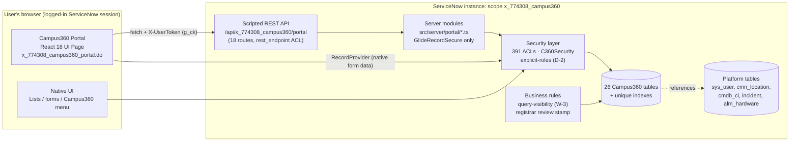
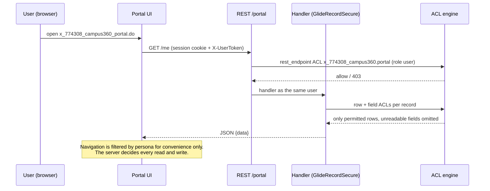
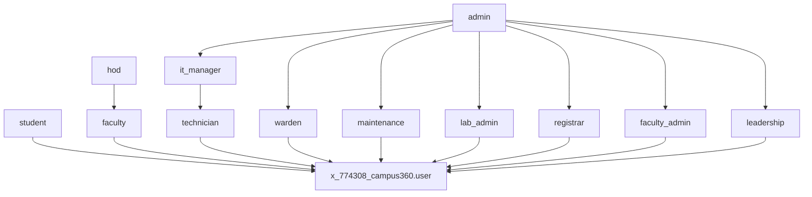
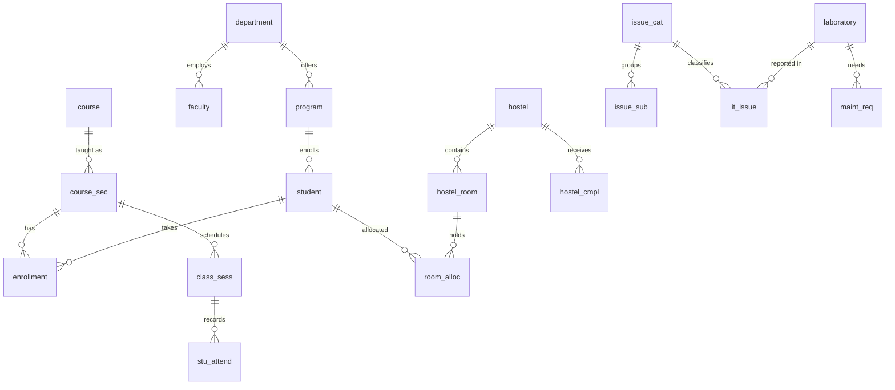

# Campus360 System Architecture

> Scope `x_774308_campus360` · package `campus360` v2.0.0 · ServiceNow SDK 4.14.0 · instance dev382380 (Australia) · 2026-11-11
> Covers what is **built**. Planned later parts are marked *(planned)*.

## 1. Overview
Campus360 runs entirely **inside one ServiceNow instance**. There is no external frontend, external database, or service account. Every layer (UI, API, data, security) runs in the same scoped application and the **same user session**.

## 2. Layers
| Layer | Implementation | Source |
|---|---|---|
| Presentation (new) | One React 18.2 UI Page using `@servicenow/react-components` (Horizon/Polaris), URL-parameter routing | `src/client/**`, `src/fluent/portal/portal-page.now.ts` |
| Presentation (existing) | Application menu "Campus360" (48 modules + portal module), table forms and list layouts | `src/fluent/menu`, `src/fluent/layouts` |
| API | Scripted REST service `portal` v1, 18 operations, all with `authentication`, `authorization` and `enforce_acl = x_774308_campus360.portal` (role `x_774308_campus360.user`) | `src/fluent/portal/portal-api.now.ts` |
| Server logic | Pure rules (`core.ts`, unit-tested) and handlers (`self-service`, `operations`, `academics`, `insights`) that read and write **only through `GlideRecordSecure`** as the session user | `src/server/portal/*` |
| Security | Table, field and REST ACLs; deny-unless rules for sensitive fields; relationship script include `C360Security`; explicit-role checks (D-2) | `src/fluent/security/*`, `src/server/security/*` |
| Data integrity | Unique indexes (attendance once per session/student, one active allocation, codes) and mandatory fields | `src/fluent/tables/*` |
| Business rules (9) | **Before-query visibility rules (W-3), 6:** IT Issue, Hostel Complaint, Maintenance Request, Hostel Room, Class Session, Onboarding Task. **Before-update workflow guards, 2:** `C360 IT Issue - workflow changes need group authority`, `C360 Hostel Complaint - workflow changes need hostel authority`. **Stamp, 1:** `C360 Registration - stamp registrar review` | `src/fluent/logic`, `src/fluent/portal` |
| Tests | 241 local tests; 4 ATF tests (security, integrity, portal with 7 personas, native workflow/statistics with 9 personas) | `test/**`, `src/fluent/tests/*` |

## 3. Authorization model

Principles:
1. **The frontend never authorises.** Personas (from the user's explicit Campus360 roles) only choose which screens appear; each API call is checked again by the ACLs.
2. **No elevation.** Handlers never use plain `GlideRecord`. A build test fails if one does.
3. **Client values are never trusted for ownership or state.** The caller and opened-by come from the session; a student's hostel comes from their own active allocation; state changes are limited to the backend's state set (see the workflow guide).
4. **Sensitive fields:** personal fields require explicit Campus360 registrar or faculty-admin membership (D-2). Platform admin alone is **not** enough.
5. **Aggregates:** queries on every REST-enabled table with row-conditional read ACLs (IT issues, hostel complaints, maintenance requests, hostel rooms, class sessions, onboarding tasks) are narrowed before counting (W-3). Portal statistics never use `GlideAggregate`; they iterate `GlideRecordSecure` rows (capped at 5,000 per metric).
6. **Operational authority, enforced at the platform layer (rev 3):** workflow fields on IT issues require IT manager or Campus360 admin, or a technician in the issue's assigned group. On complaints they require Campus360 admin, or the warden or assistant warden of the complaint's hostel. Enforced by:
   - conditional field ACLs, which cover forms, list editing, REST and GlideRecordSecure;
   - before-update guard BRs, which cover scripted updates;
   - the portal's own check.

   Raising a ticket never confers the right to work it.

## 4. Roles

All role names are prefixed `x_774308_campus360.`. Campus360 `admin` deliberately does **not** contain student, faculty or hod.

## 5. Data model (26 tables)
| Area | Tables (`x_774308_campus360_…`) |
|---|---|
| Academic | `department`, `program`, `course`, `acad_term`, `course_sec`, `enrollment` |
| People | `student`, `faculty`, `technician` |
| IT issues | `issue_cat`, `issue_sub`, `it_issue` (extends `task`) |
| Hostel | `hostel`, `hostel_room`, `room_alloc`, `hostel_cmpl` (task) |
| Infrastructure | `laboratory`, `maint_req` (task), `pm_schedule` |
| Attendance | `class_sess`, `stu_attend`, `fac_attend` |
| Registration and onboarding | `student_reg` (task), `fac_onboard` (task), `onboard_tsk` (task), `onb_tmpl` |

Full field-level schema: [DATABASE_SCHEMA.md](DATABASE_SCHEMA.md); relationships: [TABLE_RELATIONSHIPS.md](TABLE_RELATIONSHIPS.md).

## 6. Portal API routes
| Method and path | Purpose | Server-side gate (in addition to ACLs) |
|---|---|---|
| GET `/me` | User, personas, own student/faculty profile, active hostel, enrollments | – |
| GET `/catalog` | Categories, subcategories, labs, hostels for the request form | – |
| POST `/requests` | Create IT issue, hostel complaint or maintenance request | table `canCreate`; hostel forced to own allocation |
| GET `/requests/mine` | Caller's own requests across 3 tables | `caller/opened_by = me` |
| GET `/records/{table}/{id}` | Summary of one visible record | 404 if not visible; Campus360 tables only |
| GET `/queue` | IT work queue | technician / it_manager / admin |
| POST `/issues/{id}/action` | Lifecycle action | `canWrite` + field `canWrite` + legal transition |
| POST `/issues/{id}/assign-me` | Take ownership | `assigned_to` writable |
| GET `/hostel` | Warden's hostels, rooms, residents, complaints | warden / admin |
| POST `/complaints/{id}/action` | Complaint lifecycle | `canWrite` + transition |
| GET `/maintenance` | Visible maintenance requests | ACLs |
| GET `/classes` | Instructor's sections and recent sessions | ACLs |
| GET `/sessions/{id}/roster` | Enrolled students with existing marks | ACLs |
| POST `/sessions/{id}/attendance` | Save marks (insert or update) | ACLs + unique index |
| GET `/registrations` | Registrations in states 1, 2, 10, 11 | ACLs |
| POST `/registrations/{id}/review` | Registrar recommendation | registrar / admin + transition |
| GET `/stats` | Statistics over readable rows | GlideRecordSecure |
| GET `/admin/overview` | Readable row counts per table | admin |

## 7. Why this UI architecture
| Option | Verdict |
|---|---|
| **SDK UI Page with React** (chosen) | Supported by SDK 4.14 (`UiPage` with `.tsx` client, bundled into `sys_ux_lib_asset`). Served from the instance, uses the user's session and `g_ck` token, no extra plugins. |
| UI Builder / Next Experience custom components | Needs the separate `ui-component` CLI toolchain; not part of this SDK project. |
| Service Portal widgets | Possible, but AngularJS-based, and the request asked for React. |
| External SPA (Vercel, etc.) | **Rejected by requirement**: needs OAuth/CORS and a second hosting surface. |

## 8. Deployment artifacts (from build)
1 `sys_ui_page` · 2 `sys_ux_lib_asset` (bundle and source map) · 1 `sys_ws_definition` · 18 `sys_ws_operation` · 9 `sys_script` (business rules) · **411 ACLs**:
- the REST endpoint ACL;
- 73 personal-field ACLs gaining scripts;
- 18 workflow field ACLs gaining conditions, plus the conditional complaint work-notes read;
- 19 new manager/admin field ACLs;
- 1 own-room ACL.

Also: 1 application module · 4 ATF tests (111 steps). No table schema changes. No global tables touched. 0 record-delete actions.
