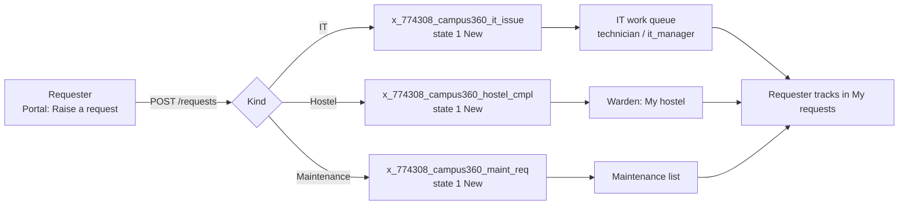
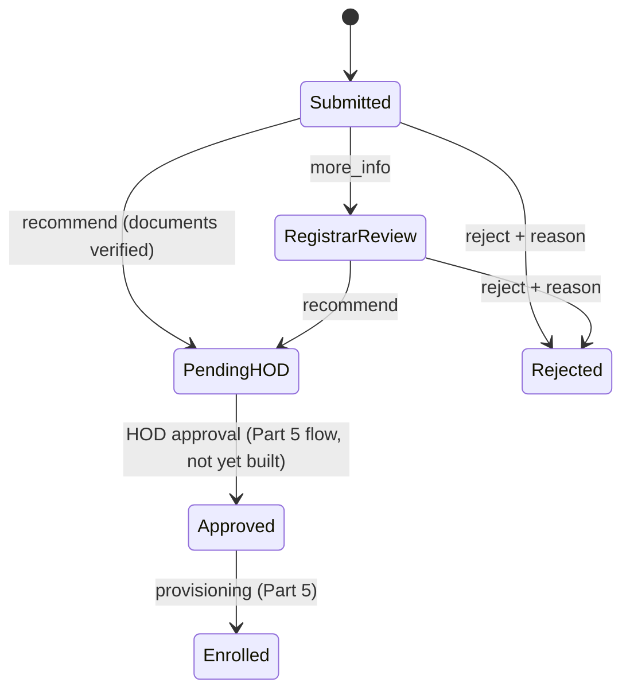

# Campus360 Workflow and Process Guide

> Describes the processes **as implemented today** (Parts 2–3 plus this portal release). Automation planned for Parts 4–9 is listed separately in §8 and is **not** active yet.

## 1. How a request flows

The caller and opened-by are always the logged-in user. Assignment group is **not** set automatically yet (assignment rules are Part 4). IT managers see every active issue, and technicians see issues for their groups or assigned to them.

## 2. IT issue lifecycle (`x_774308_campus360_it_issue`)
States: **1 New · 2 In Progress · -5 On Hold · 6 Resolved · 3 Closed · 7 Cancelled**.

```mermaid
stateDiagram-v2
  [*] --> New: raised (1)
  New --> InProgress: start (assigns to me if unassigned)
  New --> OnHold: hold + reason
  InProgress --> OnHold: hold + reason
  OnHold --> InProgress: resume
  New --> Resolved: resolve + code + notes
  InProgress --> Resolved: resolve
  OnHold --> Resolved: resolve
  Resolved --> InProgress: reopen
  New --> Cancelled: cancel
  InProgress --> Cancelled: cancel
  OnHold --> Cancelled: cancel
  Resolved --> Closed: (manual in native form; auto-close is Part 4)
```

| Action (portal) | From | To | Required input |
|---|---|---|---|
| start | 1 | 2 | – |
| hold | 1, 2 | -5 | `on_hold_reason`: awaiting_caller, awaiting_parts, awaiting_vendor, scheduled_visit |
| resume | -5 | 2 | – |
| resolve | 1, 2, -5 | 6 | `resolution_code` (fixed, workaround, hardware_replaced, config_change, user_guidance, duplicate, not_reproducible, vendor_referral, referred_maintenance) and `close_notes` (≥ 5 characters) |
| reopen | 6 | 2 | – |
| cancel | 1, 2, -5 | 7 | work note explaining why (≥ 5 characters, **enforced by the server**); the UI also asks for confirmation |
| note | 1, 2, -5, 6 | unchanged | work note |
| assign to me | any visible | – | `assigned_to` writable |

Each action also checks, on the server:
1. The record is visible to the user (404 otherwise).
2. The record is writable.
3. **Operational authority:** the user is an IT manager or Campus360 admin, or a technician who is a member of the issue's **assignment group**. Having raised the issue never counts, so a technician can't cancel or resolve their own ticket in another group.
4. **Every changed field is writable** under the field ACLs.

If any check fails, the user gets 403 and nothing changes.

**The same boundary applies outside the portal (revision 3).** In the standard ServiceNow form, list editing and the REST Table API, the workflow fields are writable only by IT managers / Campus360 admins, or by technicians of the issue's assignment group (conditional field ACLs). Scripted updates made as a user are stopped by the guard rule *C360 IT Issue - workflow changes need group authority*. The guard judges authority on the record **before** the change, and only aborts, so history is unaffected. Callers keep editing their description and adding comments. Every change is an ordinary audited update: business rules, `sys_audit` history and `sys_mod_count` / `sys_updated_by` all run, and notes are journal entries. The portal never disables workflow, audit or system fields, and never deletes; a build test enforces this.

## 3. Hostel complaint lifecycle (`x_774308_campus360_hostel_cmpl`)
Same states as IT issues. Wardens' portal buttons are Start (1→2), Hold (2→-5), Resume (-5→2) and Resolve (1/2/-5→6, resolution notes required). Comments and closing (6→3) happen in the full native record. The API also accepts `note`; the server enforces the same transition table either way. **Authority:** only a Campus360 admin, or the warden or assistant warden **of the complaint's hostel**, may act. A warden who raised a complaint in another hostel can read it (as its caller) but cannot work it, in the portal, the native form, list editing, REST or scripts. This is enforced by conditional field ACLs and the guard rule *C360 Hostel Complaint - workflow changes need hostel authority*. Resolve requires non-blank resolution notes (`close_notes`, audited) on the server. Students can raise complaints only for the hostel of their **own active room allocation**. The server ignores any other hostel value, and non-residents get 403. Confidential complaints are flagged with `is_confidential`.

## 4. Maintenance requests (`x_774308_campus360_maint_req`)
States: 1 New · 10 Scheduled · 2 In Progress · -5 On Hold · 3 Completed · 7 Cancelled. The portal creates corrective requests (`request_type = corrective`) and lists visible ones. Status changes are made in the **native form**: the portal's detail screen opens the platform form, governed by ACLs. Preventive-maintenance generation from `pm_schedule` is Part 9.

## 5. Attendance (`class_sess`, `stu_attend`)
1. The instructor (section `faculty` or co-instructor) opens **Classes & attendance** and picks a session from the last 14 days.
2. The roster lists students enrolled in the section, with any existing marks.
3. The instructor sets each student to present, absent, late, excused, medical or on_duty (remarks optional) and saves.
4. The server inserts or updates one `stu_attend` per student per session. The **unique index** prevents duplicates, and ACLs restrict marking to the session's instructors (Part 3 relationship rules).

Roster generation, submit/lock and scheduled locking are Part 7.

## 6. Student registration (`student_reg`)
States: 1 Submitted · 2 Registrar Review · 10 Pending HOD Approval · 11 Approved · 12 Rejected · 3 Enrolled · 7 Cancelled.


- Registrar review in the portal sets `registrar_recommendation`, `documents_verified`, `verification_notes` and the state. The business rule **C360 Registration - stamp registrar review** records `registrar_reviewed_by` and `registrar_reviewed_at`.
- "Recommend" is refused unless documents are verified, and "reject" needs a reason.
- **HOD approval (10 → 11) is not implemented yet.** HODs can see registrations their ACLs allow, read-only.

## 7. Faculty onboarding (`fac_onboard`, `onboard_tsk`)
Tables, states (1 Draft · 9 Awaiting Approval · 2 In Progress · -5 On Hold · 3 Completed · 8 Rejected · 7 Cancelled) and ACLs exist. Records are maintained in the native forms through the Campus360 menu. Task generation from templates is a Part 6 flow, and the portal has no onboarding screen in this release.

## 8. Not implemented yet (planned)
| Capability | Planned part |
|---|---|
| Priority from impact × urgency, assignment rules, auto-close of resolved issues, Escalate to Incident, notifications, SLAs | Part 4 |
| Registration approval flow (HOD), student provisioning | Part 5 |
| Faculty onboarding flow, task generation, laptop allocation | Part 6 |
| Roster generation, attendance lock, missing-attendance jobs | Part 7 |
| Room allocation request flow, occupancy reconciliation | Part 8 |
| PM generator, maintenance from IT issue | Part 9 |
| Service Catalog items | Later part |
