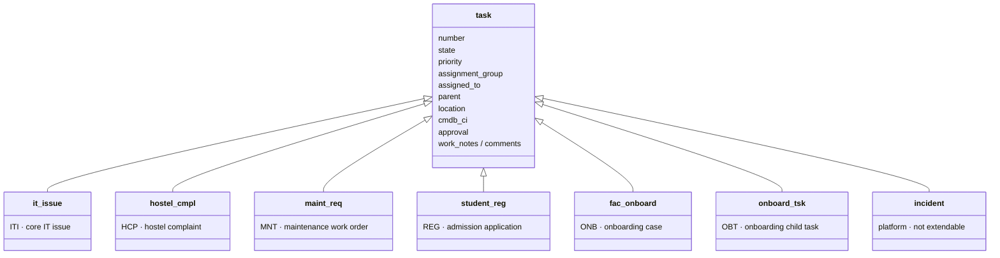
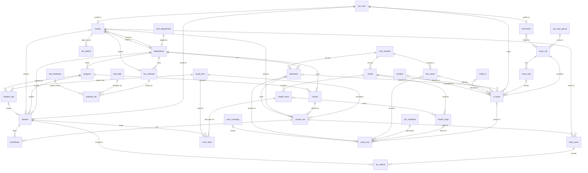

# Campus360: Table Relationships

> Short names below drop the `x_774308_campus360_` prefix. Platform tables keep their real names.

## 1. Task inheritance

Six transactional tables extend `task`. This lets them share the platform's assignment, approval, SLA, activity stream, watch list, Flow Designer triggers, notifications and reporting features without rebuilding any of them.

**Why not extend `incident`?** The instance reports `incident.is_extendable = false`, so extending it isn't possible here. It would also bring in ITSM incident business rules, ITIL-role ACLs and fulfiller licensing that students and faculty shouldn't need. Instead, `it_issue.escalated_incident` links a campus issue to a central IT incident when a problem spreads beyond the campus.

## 2. Entity relationship diagram

## 3. Reference field catalogue

| From table.field | → To table | Cardinality | Cascade on delete | Reference qualifier |
|---|---|---|---|---|
| student.user | sys_user | 1:1 (unique) | **restrict** | `active=true` |
| faculty.user | sys_user | 1:1 (unique) | **restrict** | `active=true` |
| technician.user | sys_user | 1:1 (unique) | restrict | `active=true` |
| department.hod | faculty | N:1 | clear | `department=<current>^status=active` |
| department.platform_dept | cmn_department | 1:1 | clear | – |
| department.building | cmn_location | N:1 | clear | – |
| program.department | department | N:1 | **restrict** | `active=true` |
| course.department / course.program | department / program | N:1 | restrict / clear | `active=true` |
| course_sec.course · .term · .faculty | course · acad_term · faculty | N:1 | restrict | active / `status=active` |
| course_sec.laboratory · .room | laboratory · cmn_location | N:1 | clear | – |
| enrollment.student · .course_section | student · course_sec | N:1 | **restrict** | `status=active` |
| student.department · .program · .admission_term · .advisor | department · program · acad_term · faculty | N:1 | restrict / clear | program filtered by department |
| class_sess.course_section · .faculty | course_sec · faculty | N:1 | restrict | `status=active` |
| stu_attend.class_session · .student | class_sess · student | N:1 | **restrict** | – |
| fac_attend.faculty | faculty | N:1 | restrict | – |
| hostel.location · .warden · .assistant_warden | cmn_location · sys_user | N:1 | clear | warden role |
| hostel_room.hostel | hostel | N:1 | **restrict** | – |
| room_alloc.student · .hostel_room · .term | student · hostel_room · acad_term | N:1 | **restrict** | available rooms only |
| hostel_cmpl.hostel · .hostel_room · .student · .caller | hostel · hostel_room · student · sys_user | N:1 | clear | room filtered by hostel |
| issue_cat.assignment_group | sys_user_group | N:1 | restrict | `nameSTARTSWITHC360` |
| issue_sub.category | issue_cat | N:1 | **cascade** (subcategories have no meaning without their category) | – |
| it_issue.caller | sys_user | N:1 | clear | `active=true` |
| it_issue.category · .subcategory | issue_cat · issue_sub | N:1 | restrict / clear | sub filtered by category |
| it_issue.laboratory · .hostel · .hostel_room | laboratory · hostel · hostel_room | N:1 | clear | room filtered by hostel |
| it_issue.affected_asset | alm_asset | N:1 | clear | location-aware (advanced qualifier) |
| it_issue.escalated_incident | incident | N:1 | clear | – |
| it_issue.department | department | N:1 | clear | – |
| technician.skills | issue_cat | M:N (List) | – | `active=true` |
| technician.primary_group | sys_user_group | N:1 | clear | `nameSTARTSWITHC360` |
| laboratory.department · .location · .lab_incharge · .support_group | department · cmn_location · faculty · sys_user_group | N:1 | restrict / clear | – |
| maint_req.laboratory · .hostel · .hostel_room · .asset · .vendor · .pm_plan | … · core_company · pm_schedule | N:1 | clear | vendor=true |
| pm_schedule.location · .laboratory · .asset · .assignment_group | cmn_location · laboratory · alm_asset · sys_user_group | N:1 | clear | – |
| student_reg.program · .admission_term | program · acad_term | N:1 | restrict | `registration_open=true` |
| student_reg.created_user · .created_student | sys_user · student | 1:1 | clear | – |
| fac_onboard.department · .reporting_to · .office_location | department · faculty · cmn_location | N:1 | restrict / clear | – |
| fac_onboard.lab_access | laboratory | M:N (List) | – | – |
| onboard_tsk.onboarding (+ task.parent) | fac_onboard | N:1 | **cascade** | – |
| onboard_tsk.template · .allocated_asset | onb_tmpl · alm_hardware | N:1 | clear | `install_status=6` (In stock) |

**Cascade policy:** People, structure and attendance use **restrict**, so a record can't be deleted while anything depends on it. Records are deactivated, never deleted, which keeps attendance history and audit intact. Optional links use **clear**. Only pure child or configuration records use **cascade**.

## 4. Task parent/child chains

| Parent | Child | Created by | Purpose |
|---|---|---|---|
| it_issue | maint_req (`parent`) | UI action "Create Maintenance Request" | Building or electrical faults that need facilities work |
| hostel_cmpl | maint_req (`parent`) | UI action / flow | Plumbing, electrical or furniture repair |
| hostel_cmpl | it_issue | Record producer routing | A hostel Wi-Fi report becomes an it_issue (`hostel_wifi`) |
| fac_onboard | onboard_tsk (`parent` + `onboarding`) | Onboarding flow, from `onb_tmpl` | Checklist |
| student_reg | sysapproval_approver | Registration flow | Registrar or HOD approval |
| it_issue | incident (`escalated_incident`) | UI action "Escalate to Incident" | Central IT escalation (one way) |
| sc_req_item | sc_task | Catalog fulfilment flows | Generic service requests |

## 5. Explicit relationships (`sys_relationship`) and related lists

Most related lists come from reference fields (implicit). Explicit relationships are needed only where no reference field links the records:

| Name | Applies to (parent form) | Queries from | Query logic |
|---|---|---|---|
| C360 Lab Assets | laboratory | alm_asset | `location = parent.location` |
| C360 Lab CIs | laboratory | cmdb_ci | `location = parent.location` |
| C360 Student Issues | student | it_issue | `caller = parent.user` |
| C360 Student Attendance Summary | student | enrollment | `student = parent.sys_id` (implicit; listed for completeness) |
| C360 Room Occupants | hostel_room | student | `sys_id IN (active room_alloc.student for this room)` |
| C360 Faculty Sessions Today | faculty | class_sess | `faculty = parent^session_date = today` |

Related lists per form (Part 2):
- **Department:** Programs, Courses, Faculty, Students, Laboratories
- **Student:** Enrollments, Attendance, Room Allocations, IT Issues, Hostel Complaints
- **Faculty:** Course Sections, Class Sessions, Faculty Attendance, Advisees (students)
- **Course Section:** Enrollments, Class Sessions
- **Class Session:** Student Attendance
- **Hostel:** Rooms, Complaints · **Hostel Room:** Allocations, Complaints, Occupants
- **Laboratory:** Lab Assets, Lab CIs, IT Issues, Maintenance Requests, Course Sections
- **IT Issue:** Child Maintenance Requests, Task SLAs, Approvals
- **Faculty Onboarding:** Onboarding Tasks, Approvals

## 6. Integrity rules spanning several tables

| Rule | Mechanism |
|---|---|
| One profile per user (student, faculty, technician) | Unique index on `user` |
| No duplicate attendance | Unique (`class_session`,`student`) and (`faculty`,`attendance_date`) |
| No duplicate enrollment | Unique (`student`,`course_section`) |
| No duplicate section or session | Unique (`course`,`term`,`section`) and (`course_section`,`session_date`,`start_time`) |
| Attendance only for enrolled students | Before business rule on `stu_attend` |
| Room capacity and one active allocation per student | Before business rule plus aggregate recount plus nightly reconcile (DATABASE_SCHEMA §5.3) |
| Section capacity | Before business rule on `enrollment` |
| Only one current term | After business rule on `acad_term` |
| Program belongs to the student's department | Reference qualifier plus before business rule |
| Faculty can't have overlapping sessions | Before business rule on `class_sess` |
